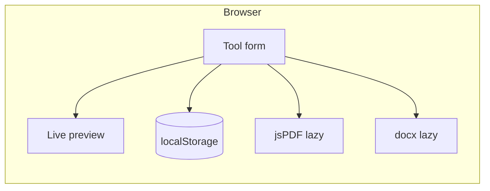

# Docuklin

Live site: **[https://docuklin.com](https://docuklin.com)**

Free **niche business document generators**: fill a form in the browser, live preview, export **PDF** or **DOCX**. Nothing is stored server-side; optional **localStorage** drafts stay on your device.

Brand, domain, and related identity are configured via environment variables — see [`docs/CONFIGURATION.md`](docs/CONFIGURATION.md) and `.env.example`.



## Tools (30)

| Tool | Path |
|------|------|
| Construction estimate | `/tools/construction-estimate-template/` |
| Roofing estimate | `/tools/roofing-estimate/` |
| Painting estimate | `/tools/painting-estimate/` |
| Landscaping estimate | `/tools/landscaping-estimate/` |
| Flooring estimate | `/tools/flooring-estimate/` |
| Contractor invoice | `/tools/contractor-invoice/` |
| Progress invoice | `/tools/progress-invoice/` |
| Invoice late fee calculator | `/tools/invoice-late-fee-calculator/` |
| Photography contract | `/tools/photography-contract-template/` |
| Videography contract | `/tools/videography-contract/` |
| Wedding videography contract | `/tools/wedding-videography-contract-template/` |
| Video production contract | `/tools/video-production-contract/` |
| Podcast script | `/tools/podcast-script-template/` |
| Real estate flyer | `/tools/real-estate-flyer-template/` |
| Tattoo consent form | `/tools/tattoo-consent-form-template/` |
| Freelance / web design contract | `/tools/freelance-web-design-contract/` |
| Cleaning invoice / estimate | `/tools/cleaning-service-invoice/` |
| Catering quote | `/tools/catering-quote/` |
| Event / wedding vendor contract | `/tools/event-wedding-vendor-contract/` |
| Rental / lease application | `/tools/rental-lease-application/` |
| Simple NDA | `/tools/simple-nda/` |
| Work order | `/tools/work-order/` |
| Receipt generator | `/tools/receipt-generator/` |
| Quote / estimate | `/tools/quote-estimate-generator/` |
| Independent contractor agreement | `/tools/independent-contractor-agreement/` |
| Timesheet template | `/tools/timesheet-template/` |
| Service agreement | `/tools/service-agreement-template/` |
| Purchase order | `/tools/purchase-order-template/` |
| Change order | `/tools/change-order-template/` |
| Lien waiver | `/tools/lien-waiver-generator/` |

Hubs: `/hubs/estimates-invoices/`, `/hubs/contracts/`, `/hubs/forms/`, `/hubs/creative-templates/`

## Embed this tool

Every tool page has an **Embed this tool** section with a copy-paste iframe snippet. The embeddable URL is `/tools/<slug>/embed/` (e.g. [https://docuklin.com/tools/quote-estimate-generator/embed/](https://docuklin.com/tools/quote-estimate-generator/embed/)).

- Embed pages are `noindex, follow` and canonical to the parent tool.
- A visible **Made with Docuklin** credit links to the canonical tool page (dofollow). Keep that line when you paste the snippet.
- Example snippet shape:

```html
<iframe src="https://docuklin.com/tools/quote-estimate-generator/embed/" title="Free Estimate Generator" width="100%" height="720" loading="lazy" style="border:0;max-width:100%;"></iframe>
<p>Made with <a href="https://docuklin.com/tools/quote-estimate-generator/">Docuklin</a></p>
```

## Stack

- [Astro 5](https://astro.build) static output + TypeScript
- React island (`client:visible`) for generators only
- jsPDF + docx lazy-loaded on export

## Folder structure

```
src/config/site.ts       # Owner placeholders (domain, AdSense, GA4)
src/data/tools/          # Tool definitions + SEO content
src/components/generators/
src/pages/               # Routes, hubs, guides, trust pages
docs/                    # DEPLOYMENT, SEO-GUIDE, ADSENSE, research
scripts/audit/           # npm run audit
```

## Local setup

```bash
npm ci
npm run dev      # http://localhost:4321
npm run build
npm run preview
```

## Scripts

| Script | Description |
|--------|-------------|
| `npm test` | Vitest — form validation + PDF export |
| `npm run audit` | SEO, AI-style guides check, AdSense readiness, JS budget, internal links |
| `npm run audit:ai-style` | Heuristic human-voice check for guides |
| `npm run check` | test + audit |
| `npx lhci autorun` | Lighthouse mobile (after build) |

## Configuration (`src/config/site.ts`)

Set via `PUBLIC_*` env vars at deploy time:

- `PUBLIC_SITE_URL`, `PUBLIC_SITE_NAME`, `PUBLIC_CONTACT_EMAIL`
- `PUBLIC_ADSENSE_PUBLISHER_ID`, `PUBLIC_ADS_ENABLED`, `PUBLIC_ADSENSE_AUTO_ADS`
- `PUBLIC_ADSENSE_SLOT_DISPLAY` (numeric in-page unit id); optional `PUBLIC_ADSENSE_SLOT_HOME` / `PUBLIC_ADSENSE_SLOT_TOOL`
- `PUBLIC_DIRECTORY_BADGES` — JSON array of footer badges (`href`, `img`, `alt`, optional `width`/`height`/`rel`); invalid JSON → warn + no badges; when unset, Fazier fallback via `PUBLIC_FAZIER_BADGE_ENABLED`
- `PUBLIC_GA4_MEASUREMENT_ID`
- `PUBLIC_GSC_VERIFICATION` (alias: `PUBLIC_GOOGLE_SITE_VERIFICATION`), `PUBLIC_BING_SITE_VERIFICATION`
- `PUBLIC_INDEXNOW_KEY` (file in `public/`)

## Adding a tool or article

See **AGENTS.md** and `.cursor/skills/add-new-tool/SKILL.md`.

## UI / UX changes

For any change to how the site looks or behaves, follow **[UI/UX Pro Max](AGENTS.md#uiux-pro-max)** in `AGENTS.md`: read `.cursor/skills/ui-ux-pro-max/SKILL.md` and run `python3 .cursor/skills/ui-ux-pro-max/scripts/search.py "<query>" --domain <domain>` (plus `--design-system` / `--stack astro` when listed in the skill).

## Proof (SEO, performance, AdSense)

Committed, reproducible evidence lives in **[docs/proof/](docs/proof/)** (Lighthouse HTML/JSON, audits, structured-data extracts, mobile screenshots, bundle sizes).

```bash
npm run proof   # rebuilds dist and regenerates docs/proof/
```

## Audits & CI

PR / `main` CI: path-filtered parallel `build` + `test` jobs (npm cache, Astro/Vite cache, `npm ci --prefer-offline --no-audit --fund=false`), with concurrency cancel-in-progress. Docs-only changes skip the heavy jobs but still report the required `build-test-audit-proof` check. Run `npm run audit`, `npm run proof`, and `npx lhci autorun` locally before opening PRs. The **Full checks** workflow (Actions → workflow_dispatch) caches Playwright Chromium and runs audits, proof, and Lighthouse on demand.

## SEO / AdSense / deploy

- **[docs/DEPLOYMENT.md](docs/DEPLOYMENT.md)** — full step-by-step: DNS, Cloudflare Workers Builds (`wrangler.jsonc`), env vars (see `.env.example`), GSC, AdSense, launch checklist
- **[docs/GROWTH-STATUS.md](docs/GROWTH-STATUS.md)** — living Done / Remaining queue + GSC/GA4 baseline (update in every PR)
- [docs/SEO-GUIDE.md](docs/SEO-GUIDE.md)
- [docs/ADSENSE.md](docs/ADSENSE.md)
- [docs/SEO-PLAYBOOK.md](docs/SEO-PLAYBOOK.md)
- [docs/KEYWORD-MAP.md](docs/KEYWORD-MAP.md)
- [docs/ideas/README.md](docs/ideas/README.md) — all 23 research ideas (#20 built here)
- **Agent SEO rules:** [`AGENTS.md`](AGENTS.md) §5, [`.cursor/rules/seo.mdc`](.cursor/rules/seo.mdc), skill [`.cursor/skills/add-seo-page/SKILL.md`](.cursor/skills/add-seo-page/SKILL.md)

### After every production deploy (IndexNow + GSC)

1. IndexNow already runs on Workers Builds (`npx wrangler deploy && node scripts/indexnow.mjs`). Or run `npm run indexnow` against a fresh `dist/`. The script submits **every sitemap URL** (new pages + **redirect targets**). Do **not** change the key file `public/4d6f1ea5473a0968a83c67ceda5a0387.txt`. Do not run IndexNow from a PR before deploy.
2. In Google Search Console: URL Inspection → **Request indexing** for each new or substantially changed page.

## Done / Remaining (growth & SEO)

Short mirror of [`docs/GROWTH-STATUS.md`](docs/GROWTH-STATUS.md). **Every PR must refresh both files** (see `AGENTS.md`). Do not invent metrics.

### Done (as of 2026-11-27)

- **SEO title fixes (this PR):** `/tools/videography-contract/` title → `Videography Contract Template (Free)` (drops wedding bleed; KEYWORD-MAP primary stays videography contract; branded ≤60). `/guides/wedding-videography-contract/` title → `Wedding Videography Contract: What to Include` (branded ≤60). Bumped `updatedAt`. IndexNow not run.
- **GA4 geo consent + reliability (merged #56):** Consent Mode v2 region defaults — EEA/UK/CH denied (ads + analytics) until CMP/Accept; elsewhere analytics (and ad storage) **granted** by default with Accept + **Reject / Do not sell or share** opt-out. GA loads promptly (no idle deferral). `trackEvent` queues via `dataLayer` when gtag is not ready. Cookies/privacy/rules updated. Owner decision (Sidney, 2026-11-27).
- **Earlier — GA4 Consent Mode v2 (2026-11-25):** always-load with denied defaults; superseded by geo policy above.

### Done (as of 2026-11-25)

- **Author / sameAs (earlier PR):** defaults include GitHub + Reddit (`u/ihammadiqbal117`); About bio block strengthened from in-repo facts; env hooks for LinkedIn/X/`PUBLIC_AUTHOR_BIO` remain. Owner must still supply LinkedIn, X handle, longer bio when available.
- **GSC-priority variants (this PR):** `/tools/wedding-videography-contract-template/`, `/tools/video-production-contract/`, `/tools/landscaping-estimate/`, `/tools/flooring-estimate/`; construction estimate quote-angle content (no title/H1 change); expanded near-page-1 guides; thicker hubs/home/methodology; forms/creative hub metas lengthened. Additive only—no redirects/merges.
- **Embed backlink credit (this PR):** visible **Made with Docuklin** on embed pages + copy snippet → canonical tool URL, dofollow; README links https://docuklin.com and documents embed usage.
- **Sitewide SEO plan (earlier):** tool titles/H1s/metas/FAQs; expanded videography / NDA / service agreement; contractor-estimate guide 301 → construction master; business-estimate quote angle; new guides `how-to-price-a-job`, `what-to-include-in-a-service-agreement`, `service-agreement-vs-contract`; hubs + `/tools/` title **Free Business Document Generators** with derived count; cookies/privacy/terms noindex; estimate URL + `/tools/:slug/null/` redirects; durable rules in `AGENTS.md`, `.cursor/rules/seo.mdc`, `.cursor/skills/add-seo-page/`.
- **AI Overviews / GSC generative features:** strengthened answer-first + tool links on `line-item-totals-explained`, `tattoo-consent-documentation` (URL kept), `work-order-vs-invoice-vs-estimate`. No geotargeting changes (Nigeria impression share is data only).
- **IndexNow docs:** clarified that new sitemap URLs and redirect targets are submitted post-deploy; key unchanged; GSC Request indexing after deploy (not run in this PR).
- **Agathox ownership verification (earlier):** `<meta name="agathox-verification" content="agathox-verify-9f40b3ccd8788104">` in shared Head; `/.well-known/agathox-verification.txt` static file (same token). Worker already skips `.txt` slash-redirect; Vitest covers the path.
- **PAA guides (this PR):** five AlsoAsked articles (payment terms, change order, WO vs PO vs invoice, freelance contract checklist, contractor estimate create) + `docs/WRITING-GUIDE.md` + `ai-style-check` in audit. Heuristic style **OK** for the five; HF detector not in CI image.
- **Progress invoice generator** (`/tools/progress-invoice/`): merged via dedicated agent PR #43.
- **CI / Workers Builds speedup (PR #36 merged):** parallel build+test, npm/Astro caches, faster `npm ci`, docs-only path skip with required-check gate, Playwright Chromium cache on Full checks; root `.npmrc` for Cloudflare install.
- **Change order template upgrade (this PR):** running contract total (original + prior COs + this CO), schedule days, dual signatures, FAQ polish, tests.
- **Free estimate generator upgrades (this PR):** local logo (client-only), valid-until, Convert to invoice handoff, FAQ “Can an estimate be used as an invoice?”.
- **Lien waiver generator** (`/tools/lien-waiver-generator/`): conditional/unconditional × partial/final fill-in form, live preview, PDF/DOCX, state-forms-vary disclaimer, FAQ; wired into contracts hub, KEYWORD-MAP, llms question maps, related tools (this PR).
- Homepage links tools by category; hubs’ which-document tables complete; home title/H1/tagline target contractor & freelancer templates (PR #35).
- **Progress invoice generator** (`/tools/progress-invoice/`): contract value, percent or amount complete, previously billed, retainage %, amount due, balance to finish; PDF/DOCX (this PR).
- **Lien waiver generator** (`/tools/lien-waiver-generator/`): conditional/unconditional × partial/final fill-in form, live preview, PDF/DOCX, state-forms-vary disclaimer, FAQ; wired into contracts hub, KEYWORD-MAP, llms question maps, related tools (this PR #38).
- **Progress invoice generator** (`/tools/progress-invoice/`): contract value, percent or amount complete, previously billed, retainage %, amount due, balance to finish; PDF/DOCX (merged via #43).
- **CI / Workers Builds speedup (merged to main):** parallel build+test, npm/Astro caches, faster `npm ci`, docs-only path skip with required-check gate, Playwright Chromium cache on Full checks; root `.npmrc` for Cloudflare install.
- **Humanize existing guides (this PR):** rewrote all **22** existing guides to practitioner peer voice; added `docs/WRITING-GUIDE.md` + `scripts/audit/ai-style-check.mjs` (in `npm run audit`). HF detectors: all guides **&lt;30%** AI prob. Score table in `docs/GROWTH-STATUS.md`.
- **Lien waiver generator** (`/tools/lien-waiver-generator/`): conditional/unconditional × partial/final fill-in form, live preview, PDF/DOCX (PR #38, on main).
- **Progress invoice generator** (`/tools/progress-invoice/`): contract value, percent or amount complete, previously billed, retainage %, amount due, balance to finish; PDF/DOCX (PR #43, on main).
- **CI / Workers Builds speedup (merged):** parallel build+test, npm/Astro caches, faster `npm ci`, docs-only path skip, Playwright Chromium cache (PR #36).
- Homepage links all tools by category; hubs’ which-document tables complete; home title/H1/tagline target contractor & freelancer templates (PR #35).
- **Invoice late fee calculator** (`/tools/invoice-late-fee-calculator/`): flat / monthly % / annual→daily fees, grace days, days late + new total, copy-ready late-fee line and reminder; linked from contractor/cleaning invoice tools and estimates-invoices hub (PR #37).
- **Roofing + painting estimate presets** (`/tools/roofing-estimate/`, `/tools/painting-estimate/`): trade-specific defaults on the shared commercial estimate preview (no DocumentGenerator fork); hub table + KEYWORD-MAP + llms question map + Vitest (this PR).
- Indexing audit in CI (`npm run audit:indexing`): sitemap URLs self-canonical + not noindex; embed/`/404/` intentional noindex + `X-Robots-Tag`; internal links avoid redirect sources.
- IndexNow + GSC property verification in place; AdSense application **Getting ready**.
- TinyLaunch badge removed from Workers Builds `PUBLIC_DIRECTORY_BADGES` (2026-11-19). TinyLaunch rejected **2026-11-08** (one product at a time); retry after YardTally **2026-12-07**.
- Uneed declined 2026-11-18 (saturated); listing re-positioned; re-review pending owner email reply.
- Reddit: several 2026-11-18/19 comments posted; multiple **Removed by Reddit** (new account / low karma). Details + permalinks in GROWTH-STATUS.

### Remaining

- After merge/deploy of title PR: IndexNow (key unchanged) + GSC Request indexing for `/tools/videography-contract/` and `/guides/wedding-videography-contract/`.
- After merge/deploy of geo-consent (#56): confirm GA4 Realtime counts non-EEA visits; IndexNow only if sitemap URLs changed.
- After merge/deploy (earlier variants): IndexNow + GSC Request indexing for new variant tools and thickened pages; confirm cookies/privacy/terms noindex.
- Owner: set `PUBLIC_AUTHOR_SAME_AS` / `PUBLIC_ORG_SAME_AS` / `PUBLIC_TWITTER_HANDLE` / longer `PUBLIC_AUTHOR_BIO` when LinkedIn/X profiles exist (defaults already include GitHub + Reddit).
- Construction lien waiver basics guide still open; Bing verification unset; backlinks needed.
- Pause Reddit promo until karma recovers; AdSense approval; Uneed / TinyLaunch (after 2026-12-07).
- Weekly GSC check — record owner-reported deltas only. No geotargeting from country mix. Re-check GA4 users after geo consent ships (owner).

GSC last 3 months (owner, 2026-11-25): **763** impressions, **1** click, avg pos **62.4**. Top queries include estimate generator / free, wedding videography contract, construction quote generator, video production contract. Top pages: videography-contract, contracts hub, quote-estimate-generator. Earlier 28d → 2026-11-17: **0** clicks, **486** impressions. GA4: **3** users (28d, pre–geo consent grant outside EEA/UK/CH).


## Research in repo

- `docs/MARKET-RESEARCH.md`, `docs/ideas/ideas.csv`, `docs/ideas/MORE-IDEAS.md`

## Troubleshooting

- **Build fails on Node**: use Node 20+.
- **PDF export slow first time**: expected — library loads on first click.
- **Lighthouse**: run `npm run build` then `npx lhci autorun`.

## License

Tool code: use for your deployment; set `PUBLIC_*` env vars (see `.env.example`). Canonicals, sitemap, robots.txt, and llms.txt follow `PUBLIC_SITE_URL`.
