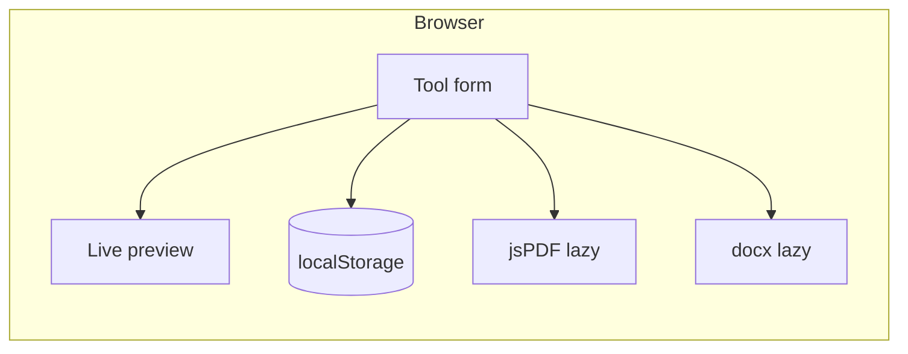

# Docuklin

Free **niche business document generators**: fill a form in the browser, live preview, export **PDF** or **DOCX**. Nothing is stored server-side; optional **localStorage** drafts stay on your device.

Brand, domain, and related identity are configured via environment variables — see [`docs/CONFIGURATION.md`](docs/CONFIGURATION.md) and `.env.example`.



## Tools (22)

| Tool | Path |
|------|------|
| Construction estimate | `/tools/construction-estimate-template/` |
| Contractor invoice | `/tools/contractor-invoice/` |
| Progress invoice | `/tools/progress-invoice/` |
| Photography contract | `/tools/photography-contract-template/` |
| Videography contract | `/tools/videography-contract/` |
| Podcast script | `/tools/podcast-script-template/` |
| Real estate flyer | `/tools/real-estate-flyer-template/` |
| Tattoo consent form | `/tools/tattoo-consent-form-template/` |
| Freelance / web design contract | `/tools/freelance-web-design-contract/` |
| Cleaning invoice / estimate | `/tools/cleaning-service-invoice/` |
| Catering quote | `/tools/catering-quote/` |
| Event / wedding vendor contract | `/tools/event-wedding-vendor-contract/` |
| Rental / lease application | `/tools/rental-lease-application/` |
| Simple NDA | `/tools/simple-nda/` |
| Work order | `/tools/work-order/` |
| Receipt generator | `/tools/receipt-generator/` |
| Quote / estimate | `/tools/quote-estimate-generator/` |
| Independent contractor agreement | `/tools/independent-contractor-agreement/` |
| Timesheet template | `/tools/timesheet-template/` |
| Service agreement | `/tools/service-agreement-template/` |
| Purchase order | `/tools/purchase-order-template/` |
| Change order | `/tools/change-order-template/` |
| Lien waiver | `/tools/lien-waiver-generator/` |

Hubs: `/hubs/estimates-invoices/`, `/hubs/contracts/`, `/hubs/forms/`, `/hubs/creative-templates/`

## Stack

- [Astro 5](https://astro.build) static output + TypeScript
- React island (`client:visible`) for generators only
- jsPDF + docx lazy-loaded on export

## Folder structure

```
src/config/site.ts       # Owner placeholders (domain, AdSense, GA4)
src/data/tools/          # Tool definitions + SEO content
src/components/generators/
src/pages/               # Routes, hubs, guides, trust pages
docs/                    # DEPLOYMENT, SEO-GUIDE, ADSENSE, research
scripts/audit/           # npm run audit
```

## Local setup

```bash
npm ci
npm run dev      # http://localhost:4321
npm run build
npm run preview
```

## Scripts

| Script | Description |
|--------|-------------|
| `npm test` | Vitest — form validation + PDF export |
| `npm run audit` | SEO, AI-style guides check, AdSense readiness, JS budget, internal links |
| `npm run audit:ai-style` | Heuristic human-voice check for guides |
| `npm run check` | test + audit |
| `npx lhci autorun` | Lighthouse mobile (after build) |

## Configuration (`src/config/site.ts`)

Set via `PUBLIC_*` env vars at deploy time:

- `PUBLIC_SITE_URL`, `PUBLIC_SITE_NAME`, `PUBLIC_CONTACT_EMAIL`
- `PUBLIC_ADSENSE_PUBLISHER_ID`, `PUBLIC_ADS_ENABLED`, `PUBLIC_ADSENSE_AUTO_ADS`
- `PUBLIC_ADSENSE_SLOT_DISPLAY` (numeric in-page unit id); optional `PUBLIC_ADSENSE_SLOT_HOME` / `PUBLIC_ADSENSE_SLOT_TOOL`
- `PUBLIC_DIRECTORY_BADGES` — JSON array of footer badges (`href`, `img`, `alt`, optional `width`/`height`/`rel`); invalid JSON → warn + no badges; when unset, Fazier fallback via `PUBLIC_FAZIER_BADGE_ENABLED`
- `PUBLIC_GA4_MEASUREMENT_ID`
- `PUBLIC_GSC_VERIFICATION` (alias: `PUBLIC_GOOGLE_SITE_VERIFICATION`), `PUBLIC_BING_SITE_VERIFICATION`
- `PUBLIC_INDEXNOW_KEY` (file in `public/`)

## Adding a tool or article

See **AGENTS.md** and `.cursor/skills/add-new-tool/SKILL.md`.

## UI / UX changes

For any change to how the site looks or behaves, follow **[UI/UX Pro Max](AGENTS.md#uiux-pro-max)** in `AGENTS.md`: read `.cursor/skills/ui-ux-pro-max/SKILL.md` and run `python3 .cursor/skills/ui-ux-pro-max/scripts/search.py "<query>" --domain <domain>` (plus `--design-system` / `--stack astro` when listed in the skill).

## Proof (SEO, performance, AdSense)

Committed, reproducible evidence lives in **[docs/proof/](docs/proof/)** (Lighthouse HTML/JSON, audits, structured-data extracts, mobile screenshots, bundle sizes).

```bash
npm run proof   # rebuilds dist and regenerates docs/proof/
```

## Audits & CI

PR / `main` CI: path-filtered parallel `build` + `test` jobs (npm cache, Astro/Vite cache, `npm ci --prefer-offline --no-audit --fund=false`), with concurrency cancel-in-progress. Docs-only changes skip the heavy jobs but still report the required `build-test-audit-proof` check. Run `npm run audit`, `npm run proof`, and `npx lhci autorun` locally before opening PRs. The **Full checks** workflow (Actions → workflow_dispatch) caches Playwright Chromium and runs audits, proof, and Lighthouse on demand.

## SEO / AdSense / deploy

- **[docs/DEPLOYMENT.md](docs/DEPLOYMENT.md)** — full step-by-step: DNS, Cloudflare Workers Builds (`wrangler.jsonc`), env vars (see `.env.example`), GSC, AdSense, launch checklist
- **[docs/GROWTH-STATUS.md](docs/GROWTH-STATUS.md)** — living Done / Remaining queue + GSC/GA4 baseline (update in every PR)
- [docs/SEO-GUIDE.md](docs/SEO-GUIDE.md)
- [docs/ADSENSE.md](docs/ADSENSE.md)
- [docs/SEO-PLAYBOOK.md](docs/SEO-PLAYBOOK.md)
- [docs/KEYWORD-MAP.md](docs/KEYWORD-MAP.md)
- [docs/ideas/README.md](docs/ideas/README.md) — all 23 research ideas (#20 built here)

## Done / Remaining (growth & SEO)

Short mirror of [`docs/GROWTH-STATUS.md`](docs/GROWTH-STATUS.md). **Every PR must refresh both files** (see `AGENTS.md`). Do not invent metrics.

### Done (as of 2026-11-19)

- **Humanize existing guides (this PR):** rewrote all **22** existing guides to practitioner peer voice; added `docs/WRITING-GUIDE.md` + `scripts/audit/ai-style-check.mjs` (in `npm run audit`). HF detectors: all guides **&lt;30%** AI prob. Score table in `docs/GROWTH-STATUS.md`.
- **Lien waiver generator** (`/tools/lien-waiver-generator/`): conditional/unconditional × partial/final fill-in form, live preview, PDF/DOCX (PR #38, on main).
- **Progress invoice generator** (`/tools/progress-invoice/`): contract value, percent or amount complete, previously billed, retainage %, amount due, balance to finish; PDF/DOCX (PR #43, on main).
- **CI / Workers Builds speedup (merged):** parallel build+test, npm/Astro caches, faster `npm ci`, docs-only path skip, Playwright Chromium cache (PR #36).
- Homepage links all tools by category; hubs’ which-document tables complete; home title/H1/tagline target contractor & freelancer templates (PR #35).
- Indexing audit in CI (`npm run audit:indexing`): sitemap URLs self-canonical + not noindex; embed/`/404/` intentional noindex + `X-Robots-Tag`; internal links avoid redirect sources.
- IndexNow + GSC property verification in place; AdSense application **Getting ready**.
- TinyLaunch badge removed from Workers Builds `PUBLIC_DIRECTORY_BADGES` (2026-11-19). TinyLaunch rejected **2026-11-08** (one product at a time); retry after YardTally **2026-12-07**.
- Uneed declined 2026-11-18 (saturated); listing re-positioned; re-review pending owner email reply.
- Reddit: several 2026-11-18/19 comments posted; multiple **Removed by Reddit** (new account / low karma). Details + permalinks in GROWTH-STATUS.

### Remaining

- Five new PAA article slugs (separate PR #46); estimate/change-order upgrade PRs (#47/#48) still open.
- Dedicated “construction lien waiver basics” guide (SEO-GUIDE calendar) still open.
- Validate GSC indexing after deploys (IndexNow + URL Inspection for `/tools/lien-waiver-generator/`, `/tools/progress-invoice/`); expect embed/404 noindex exclusions to stay.
- Confirm CI wall-clock vs baseline (~33–47s); set Workers Builds **Install command** to flagged `npm ci` if the dashboard override ignores `.npmrc`.
- Bing verification **unset**; author/`sameAs` env vars **unset**; editorial backlinks still needed.
- Pause Reddit promo/launch posts until karma recovers; r/SideProject launch was removed and not reposted.
- GA4 Consent Mode cookieless measurement; AdSense approval; Uneed re-review; TinyLaunch resubmit after 2026-12-07.
- Related tool variants / directory submissions — ongoing off-page (progress invoice shipped; other niches still open).

GSC 28d → 2026-11-17 (owner): **0** clicks, **486** impressions, avg position **58.9**, **54** indexed / **7** not. GA4: **3** users (28d).

## Research in repo

- `docs/MARKET-RESEARCH.md`, `docs/ideas/ideas.csv`, `docs/ideas/MORE-IDEAS.md`

## Troubleshooting

- **Build fails on Node**: use Node 20+.
- **PDF export slow first time**: expected — library loads on first click.
- **Lighthouse**: run `npm run build` then `npx lhci autorun`.

## License

Tool code: use for your deployment; set `PUBLIC_*` env vars (see `.env.example`). Canonicals, sitemap, robots.txt, and llms.txt follow `PUBLIC_SITE_URL`.
