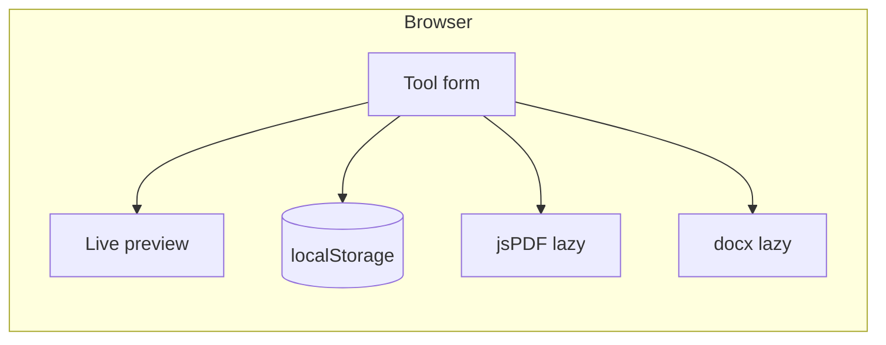

# DocuForge Tools

Free **niche business document generators**: fill a form in the browser, live preview, export **PDF** or **DOCX**. Nothing is stored server-side; optional **localStorage** drafts stay on your device.



## Tools (16)

| Tool | Path |
|------|------|
| Construction estimate | `/tools/construction-estimate-template/` |
| Contractor invoice | `/tools/contractor-invoice/` |
| Photography contract | `/tools/photography-contract-template/` |
| Videography contract | `/tools/videography-contract/` |
| Podcast script | `/tools/podcast-script-template/` |
| Real estate flyer | `/tools/real-estate-flyer-template/` |
| Tattoo consent form | `/tools/tattoo-consent-form-template/` |
| Freelance / web design contract | `/tools/freelance-web-design-contract/` |
| Cleaning invoice / estimate | `/tools/cleaning-service-invoice/` |
| Catering quote | `/tools/catering-quote/` |
| Event / wedding vendor contract | `/tools/event-wedding-vendor-contract/` |
| Rental / lease application | `/tools/rental-lease-application/` |
| Simple NDA | `/tools/simple-nda/` |
| Work order | `/tools/work-order/` |
| Receipt generator | `/tools/receipt-generator/` |
| Quote / estimate | `/tools/quote-estimate-generator/` |

Hubs: `/hubs/estimates-invoices/`, `/hubs/contracts/`, `/hubs/forms/`, `/hubs/creative-templates/`

## Stack

- [Astro 5](https://astro.build) static output + TypeScript
- React island (`client:visible`) for generators only
- jsPDF + docx lazy-loaded on export

## Folder structure

```
src/config/site.ts       # Owner placeholders (domain, AdSense, GA4)
src/data/tools/          # Tool definitions + SEO content
src/components/generators/
src/pages/               # Routes, hubs, guides, trust pages
docs/                    # DEPLOYMENT, SEO-GUIDE, ADSENSE, research
scripts/audit/           # npm run audit
```

## Local setup

```bash
npm ci
npm run dev      # http://localhost:4321
npm run build
npm run preview
```

## Scripts

| Script | Description |
|--------|-------------|
| `npm test` | Vitest — form validation + PDF export |
| `npm run audit` | SEO, AdSense readiness, JS budget, internal links |
| `npm run check` | test + audit |
| `npx lhci autorun` | Lighthouse mobile (after build) |

## Configuration (`src/config/site.ts`)

Set via `PUBLIC_*` env vars at deploy time:

- `PUBLIC_SITE_URL`, `PUBLIC_SITE_NAME`, `PUBLIC_CONTACT_EMAIL`
- `PUBLIC_ADSENSE_PUBLISHER_ID`, `PUBLIC_ADS_ENABLED`
- `PUBLIC_GA4_MEASUREMENT_ID`
- `PUBLIC_GSC_VERIFICATION` (alias: `PUBLIC_GOOGLE_SITE_VERIFICATION`), `PUBLIC_BING_SITE_VERIFICATION`
- `PUBLIC_INDEXNOW_KEY` (file in `public/`)

## Adding a tool or article

See **AGENTS.md** and `.cursor/skills/add-new-tool/SKILL.md`.

## Proof (SEO, performance, AdSense)

Committed, reproducible evidence lives in **[docs/proof/](docs/proof/)** (Lighthouse HTML/JSON, audits, structured-data extracts, mobile screenshots, bundle sizes).

```bash
npm run proof   # rebuilds dist and regenerates docs/proof/
```

## Audits & CI

GitHub Actions runs `npm run proof` and uploads `docs/proof/` as a workflow artifact.

## SEO / AdSense / deploy

- **[docs/DEPLOYMENT.md](docs/DEPLOYMENT.md)** — full step-by-step: DNS, Cloudflare Workers Builds (`wrangler.jsonc`), env vars (see `.env.example`), GSC, AdSense, launch checklist
- [docs/SEO-GUIDE.md](docs/SEO-GUIDE.md)
- [docs/ADSENSE.md](docs/ADSENSE.md)
- [docs/SEO-PLAYBOOK.md](docs/SEO-PLAYBOOK.md)
- [docs/KEYWORD-MAP.md](docs/KEYWORD-MAP.md)
- [docs/ideas/README.md](docs/ideas/README.md) — all 23 research ideas (#20 built here)

## Research in repo

- `docs/MARKET-RESEARCH.md`, `docs/ideas/ideas.csv`, `docs/ideas/MORE-IDEAS.md`

## Troubleshooting

- **Build fails on Node**: use Node 20+.
- **PDF export slow first time**: expected — library loads on first click.
- **Lighthouse**: run `npm run build` then `npx lhci autorun`.

## License

Tool code: use for your deployment; set `PUBLIC_*` env vars (see `.env.example`). Canonicals, sitemap, robots.txt, and llms.txt follow `PUBLIC_SITE_URL`.
